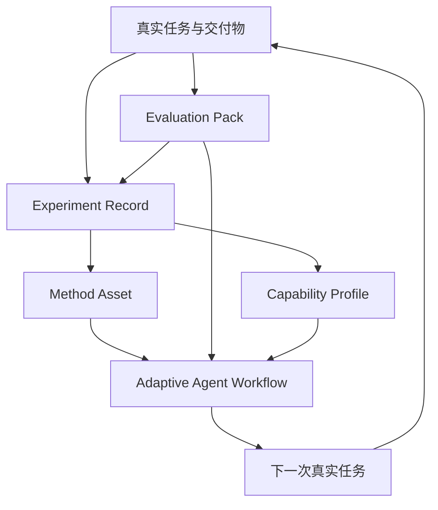

# open-agent-evals

**Open Agent Evaluation & Method Assets**

面向真实 Agent 任务的评测资产、实验记录、专业方法与模型能力画像仓库。

> 核心目标：让每一次有复用价值的任务，都能为下一次任务提供更好的评测基线、方法选择和能力判断。

## 定位

本仓库不是单纯的模型排行榜、Benchmark 集合或 Skills 仓库。它维护四类相互关联但不可混淆的资产：

1. **Evaluation Packs**：可复用的任务、输入、评价标准、参考工件与执行说明。
2. **Method Assets**：从真实任务中提出、经过实验验证并明确适用边界的方法。
3. **Experiment Records**：记录模型、工作流、工具、预算、环境、结果和证据的可复核实验。
4. **Capability Profiles**：描述模型/Agent/工具组合在特定任务条件下的能力，而非给模型做脱离场景的总排名。

## 核心原则

- Task-driven：从真实任务和真实交付物出发。
- Evidence-based：结论必须关联证据；没有数据就明确标记未采集。
- Reproducible：记录足以复现实验的条件、输入版本和执行步骤。
- Comparable：区分严格对照、生产观察和探索性实验。
- Reusable：评测资产和方法资产可跨项目复用。
- Evolvable：模型、工具和专业方法变化时，保留历史版本并重新验证。
- Lightweight：不为每个小任务建立评测包；不先建设平台、数据库或统一总分。

## 资产关系



## 仓库结构

```text
specifications/  稳定的数据结构与协议
templates/       新资产模板
domains/         各领域 Evaluation Packs
methods/         experimental / verified / recommended / deprecated 方法
models/          模型与 Agent 能力画像
experiments/     可复核实验记录
assets/          经许可可复用的 fixtures、参考工件
reports/         分析报告与模型适配报告
tooling/         后续按真实需求增加的评测工具
```

## 当前状态

本仓库处于 **bootstrap / v0.1.0-draft**：

- 已建立资产分类、状态生命周期和基础 YAML Schema。
- 已提供软件工程与游戏开发评测包的初始骨架。
- 尚无经过本仓库协议执行的正式对照实验。
- 所有示例方法均标记为 `proposed` 或 `experimental`，不把设计假设冒充验证结论。
- 尚未建立模型排行榜，也不发布未经校准的综合分数。

## 从哪里开始

1. 阅读 [资产治理规则](GOVERNANCE.md)。
2. 阅读 [评测协议](docs/evaluation-protocol.md)。
3. 从 [Evaluation Pack 模板](templates/evaluation-pack/) 复制新评测。
4. 用 [Experiment Record 模板](templates/experiment-record/) 记录执行。
5. 只有证据充分时，才将方法从 `experimental` 晋升为 `verified`。
6. 将稳定资产接入 [Adaptive Agent Workflow](https://github.com/open-agent-power) 的能力发现和方法选择流程（具体仓库集成地址待确认）。

## 语言

当前以中文作为维护语言；Schema 字段、状态值和机器接口使用英文，便于工具消费。后续可为稳定规范补充英文版本。

## License

仓库初始化阶段暂不授予公开复用许可。确认许可证和第三方素材权利后再决定是否开源。