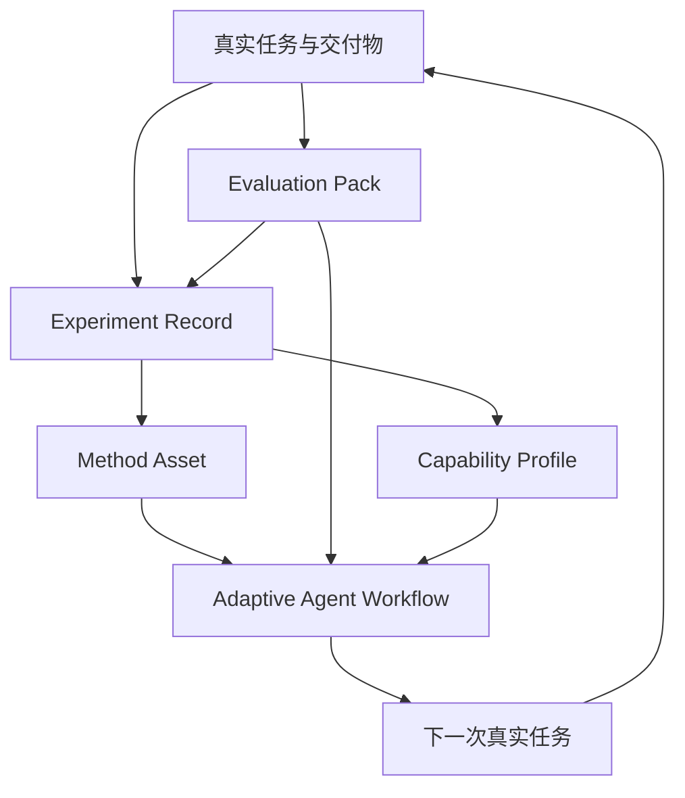

# open-agent-evals

**Open Agent Evaluation & Method Assets**

面向真实 Agent 任务的评测资产、实验记录、专业方法与模型能力画像仓库。

> 核心目标：让每一次有复用价值的任务，都能为下一次任务提供更好的评测基线、方法选择和能力判断。

## 定位

本仓库不是单纯的模型排行榜、Benchmark 集合或 Skills 仓库。它维护四类相互关联但不可混淆的资产：

1. **Evaluation Packs**：可复用的任务、输入、评价标准、参考工件与执行说明。
2. **Method Assets**：从真实任务中提出、经过实验验证并明确适用边界的方法。
3. **Experiment Records**：记录模型、工作流、工具、预算、环境、结果和证据的可复核实验。
4. **Capability Profiles**：描述模型/Agent/工具组合在特定任务条件下的能力，而非给模型做脱离场景的总排名。

## 核心原则

- Task-driven：从真实任务和真实交付物出发。
- Evidence-based：结论必须关联证据；没有数据就明确标记未采集。
- Reproducible：记录足以复现实验的条件、输入版本和执行步骤。
- Comparable：区分严格对照、生产观察和探索性实验。
- Reusable：评测资产和方法资产可跨项目复用。
- Evolvable：模型、工具和专业方法变化时，保留历史版本并重新验证。
- Lightweight：不为每个小任务建立评测包；不先建设平台、数据库或统一总分。

## 资产关系



## 仓库结构

```text
catalog.yaml     机器可读的资产索引（由 tooling/build_catalog.py 生成）
specifications/  稳定的字段约定与 YAML 示例
templates/       新资产模板
domains/         各领域 Evaluation Packs
methods/         experimental / verified / recommended / deprecated 方法
models/          模型与 Agent 能力画像
experiments/     可复核实验记录
assets/          经许可可复用的 fixtures、参考工件
reports/         分析报告与模型适配报告
tooling/         catalog 生成与资产校验
```

`catalog.yaml` 是跨仓库契约：外部编排器或 CI 在固定的 Git 引用上读取它，不需要解析 pack 内部结构。改动资产后必须运行 `python tooling/build_catalog.py` 并提交结果。

## 当前状态

本仓库处于 **bootstrap / v0.2.0-draft**：

- 已建立四类资产的字段约定和 YAML 示例；当前不是正式 JSON Schema，也不承诺可直接用于机器校验。
- **Software Engineering**：已有一个自包含 Java 17 / Maven 维护任务案例，可按说明先观察基线失败，再执行修复并复验。
- **Game Development**：已有代表场景评测包设计骨架；Rubric 仍待真实项目校准，暂不能作为已校准的正式评分基准。
- 尚无经过本仓库协议执行并复核的正式对照实验。
- 尚未建立模型排行榜，也不发布未经校准的综合分数。
- `catalog.yaml` 与 `tooling/validate.py` 已就位，CI 在每次 push / PR 校验字段、引用完整性与 catalog 新鲜度；这是字段约定的实际执行者。

## 从哪里开始

1. 阅读 [资产治理规则](GOVERNANCE.md)。
2. 阅读 [评测协议](docs/evaluation-protocol.md)。
3. 运行 `python tooling/validate.py`，确认当前资产与 catalog 一致（需要 PyYAML）。
4. 先运行 [Java 17 维护任务案例](domains/software-engineering/maintenance-task/)。
5. 阅读 [游戏代表场景评测包](domains/game-development/representative-scene/)，注意其 Rubric 尚未校准。
6. 从 [Evaluation Pack 模板](templates/evaluation-pack/) 复制新评测，改完运行 `python tooling/build_catalog.py`。
7. 用 [Experiment Record 模板](templates/experiment-record/) 记录执行。
8. 只有证据充分时，才将方法从 `experimental` 晋升为 `verified`。

## 与执行框架的关系

本仓库维护评测、方法、实验和能力画像资产；[Adaptive Agent Workflow](https://github.com/1263-ux/Adaptive-Agent-Workflow) 负责发现、选择和组织这些能力。两个仓库独立演进，通过稳定的资产 ID、版本和 Git 引用关联。

跨仓契约就是 `catalog.yaml`：执行框架在固定的 Git 引用上读取它，从中按 `status`、`domain`、`applicability` 选择资产，不解析 pack 内部字段。因此 pack 的结构可以演进，catalog 的字段不能随意变更。

## 语言

当前以中文作为维护语言；Schema 字段、状态值和机器接口使用英文，便于工具消费。后续可为稳定规范补充英文版本。

## 授权

本仓库为 **Public**，并已明确授权：

- **文档、评测包、rubric、实验记录、模板、规范与自撰 fixture**：CC BY 4.0，见 [LICENSE-CONTENT](LICENSE-CONTENT)。
- **可执行代码**（`tooling/`、评测包内的 gate 工具）：MIT，见 [LICENSE-CODE](LICENSE-CODE)。

第三方素材仍受其各自许可证约束，且默认不随仓库分发：manifest 中标注为 `bundled: false` 的 fixture 只记录获取方式与校验值。贡献者提交内容前应确认拥有相应权利。
